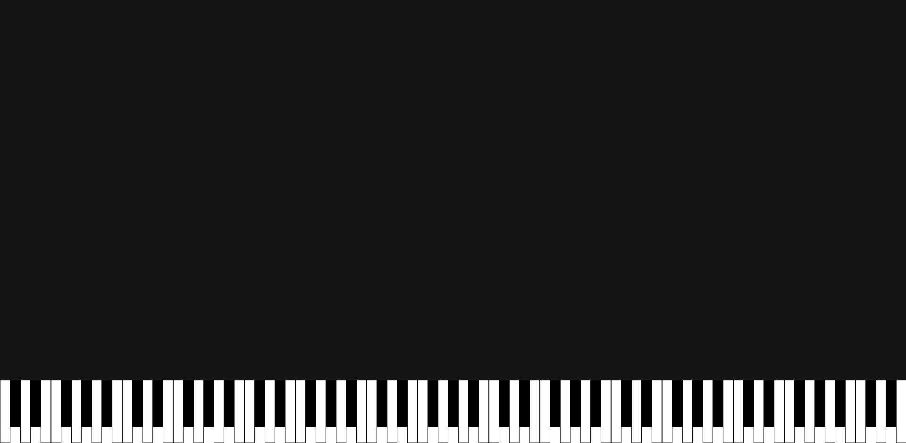

# Elise

Essentially, this is a page built using HTML, CSS, and JavaScript that makes notes to fall that simulates the style of synthesia.

## Requirements

To run this project, you will need a web browser.

You can try a demo on the GitHub Pages website in [here](https://k0l1-hub.github.io/Elise/src/Supported.html).

## AI Usage

AI is used only to help identify potential errors (and explain how to fix), including grammatical mistakes. All code is written by humans. The AI used was claude

## Contributions

Feel free to suggest improvements or contribute to the project!
License

This project is licensed under the MIT License. Anyone is free to use, modify, distribute, and even sell software incorporating this project, subject to the license terms.
Attribution

Attribution is greatly appreciated. If you use this project, mentioning the original author's name would be wonderful!

## Future Plans

- Add a functional midi
- Make more easy to understand the code
- Add a functional metronome

## Documentation of time and process

You can see the `Time documentation` folder if you want to evaluate my process doing this

:D