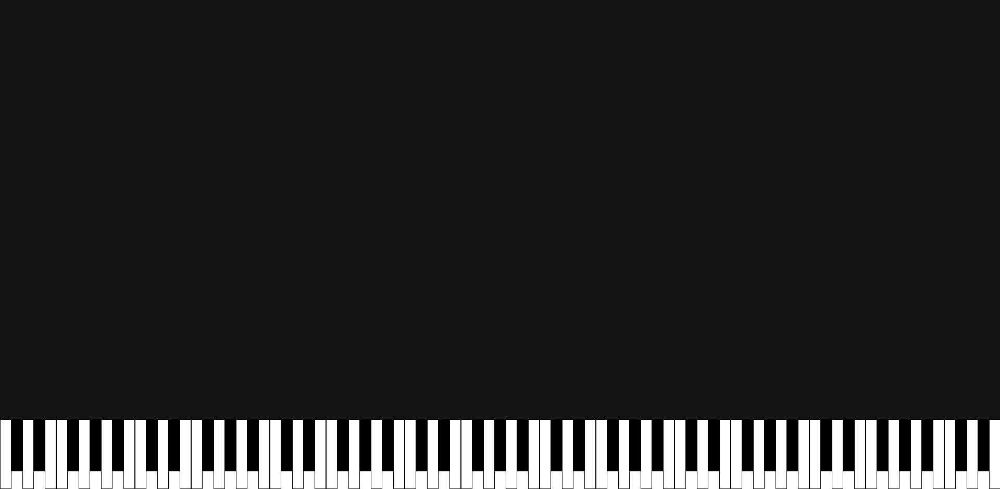

# What`s this?

As a help for the reviewers of this project to get an idea of all the process took by me, I will add this .md in each commit.

## What did I do?

### version 0.0.1

As one of my next projects I will make a website similar to synthesia to play music.

First I searched in google how to connect midi devices using javascript and I discovered THE WEB MIDI API which is as the name says, an api of the browser made to connect midi devices to the browser (In some browsers is not available, more information in [here](https://developer.mozilla.org/en-US/docs/Web/API/Web_MIDI_API)). 

Then, I made index.html, script.js, style.css, etc and I add the code presented in the first commit to show if your browser has compatibility.

This took me 1.5 hours aprox

### version 0.0.2

By this time I changed the directory system for a more organized system

Also, I connected my midi and I tried some tests with console.log()

This took me 0.5 hours aprox

### version 0.0.3

I finished a first look of the piano roll and you can change the size, maybe I will make an input question or something, browsers cant know the size of a midi instrument

This took me 1 hour and 28 minutes acording to WakaTime

### version 0.0.4

Im too tired so I will follow tomorrow, by now I finished the piano roll, I investigated about instruments for the piano and I got soundfont-player.js but its a bit complicated